# LendLoop

**Borrow what you need. Lend what you don't.**

A neighbourhood tool-lending board. Neighbours list tools, ask to borrow them for
a date range, and approve, decline and mark returns. **n8n** sends every
notification and a daily overdue reminder. Each automation run writes its result
back to the app, so a failure shows up instead of getting lost.

Built with **Next.js 15 (App Router) · TypeScript · Clerk · Convex · n8n**.

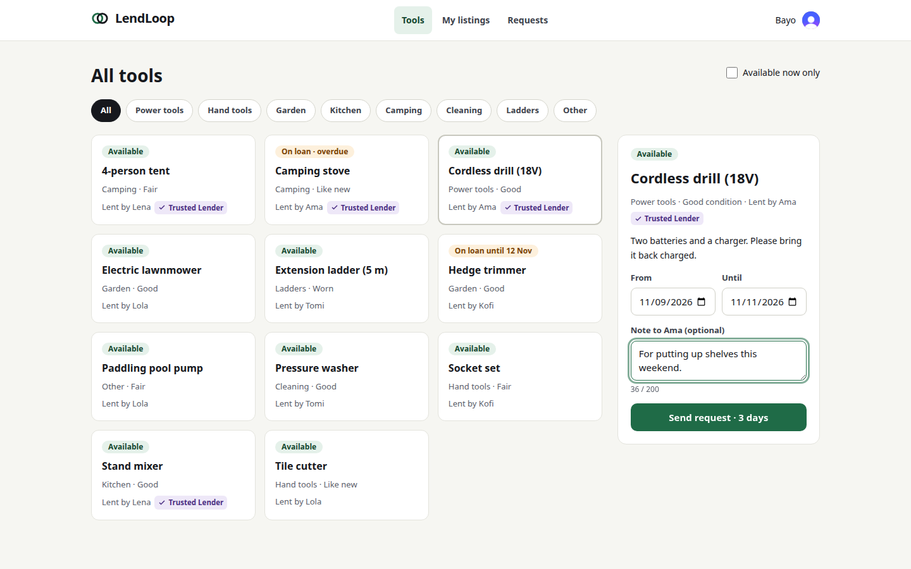

---

## Contents

1. [What it does](#what-it-does)
2. [Quick start](#quick-start)
3. [Environment variables](#environment-variables)
4. [Architecture](#architecture)
5. [Security and data minimisation](#security-and-data-minimisation)
6. [Reliability and error handling](#reliability-and-error-handling)
7. [Tests](#tests)
8. [Decisions and trade-offs](#decisions-and-trade-offs)
9. [Running this in production](#running-this-in-production)

---

## What it does

| Brief | Where |
|---|---|
| Public page: name, tagline, read-only list (name + category only), "Sign in to lend or borrow" wired to Clerk | `/` — [`app/page.tsx`](app/page.tsx), query [`tools.publicList`](convex/tools.ts) returns **only** `{name, category}` |
| Signed-in only: list a tool (name, category, condition, description) | `/listings` — `tools.create` / `update` / `remove` |
| Request to borrow for a date range | `/tools` — `loans.request` |
| Approve / decline requests on your own tools; mark a loan returned | `/requests` — `loans.approve` / `decline` / `markReturned` |
| All tools with availability, filterable by category | `/tools` — `tools.list` |
| "My listings", "My requests", "Incoming requests" | `/listings`, `/requests?tab=mine`, `/requests` |
| **admin**: remove any listing, view all loans, mark a Trusted Lender | `/admin` — [`convex/admin.ts`](convex/admin.ts) |
| **user**: create/edit/delete only their own listings; act only on their own requests and tools | [`convex/lib/auth.ts`](convex/lib/auth.ts), checked inside every function |
| n8n workflow 1: notify on request created / status change | [`n8n/workflows/01-request-notification.json`](n8n/workflows/01-request-notification.json) |
| n8n workflow 2: daily overdue reminders, fetch from a Convex HTTP endpoint, write status back | [`n8n/workflows/02-overdue-reminders.json`](n8n/workflows/02-overdue-reminders.json) |
| HMAC signing in both directions; secrets in env/credentials; idempotent write-backs | [`convex/lib/hmac.ts`](convex/lib/hmac.ts), [`convex/http.ts`](convex/http.ts), [`convex/automation.ts`](convex/automation.ts) |
| Retries + error workflow; failures visible | [`convex/outbox.ts`](convex/outbox.ts), [`n8n/workflows/03-error-handler.json`](n8n/workflows/03-error-handler.json), Admin page |
| **Bonus:** recent automation activity on each loan | Activity timeline on every request card ("Email sent to Lola · 3 minutes ago") |

Some rules the brief didn't spell out, which a real lending board needs:
- You can't borrow your own tool, book dates in the past, book more than 30 days, or book more than 90 days ahead.
- Dates already approved for someone else can't be requested.
- Approving one request **automatically declines the overlapping ones**, and those borrowers are emailed.
- A tool that is lent out can't be deleted. Deleting a listing declines its waiting requests.
- Admin removal is a soft delete with a reason, kept for the record.

<details>
<summary><b>Screenshots</b> (public page, listings, requests, admin, n8n, Mailpit)</summary>

| | |
|---|---|
| 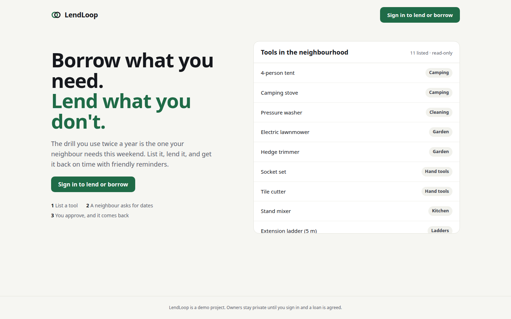 | 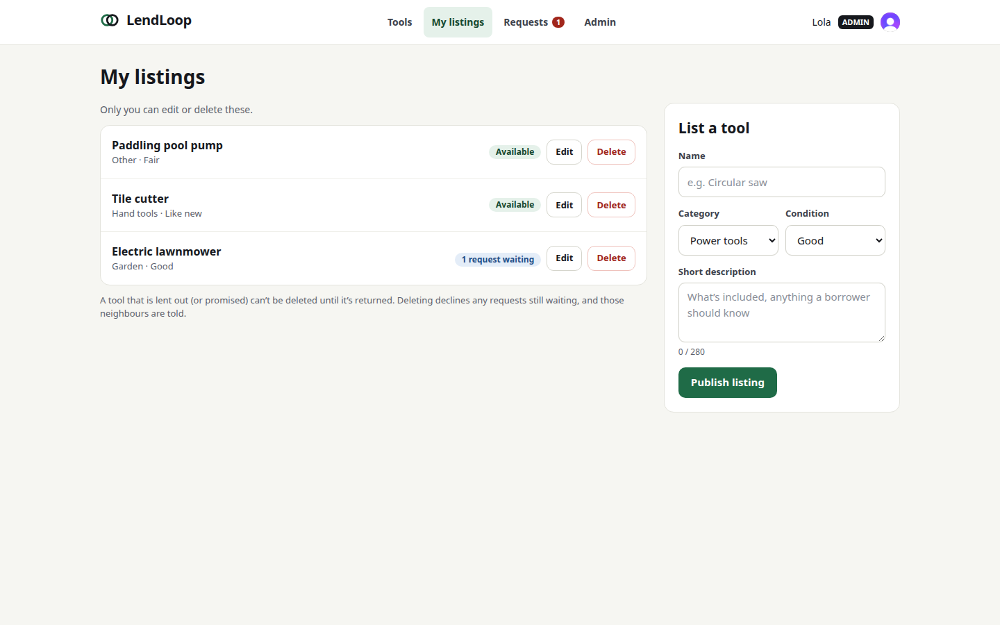 |
| 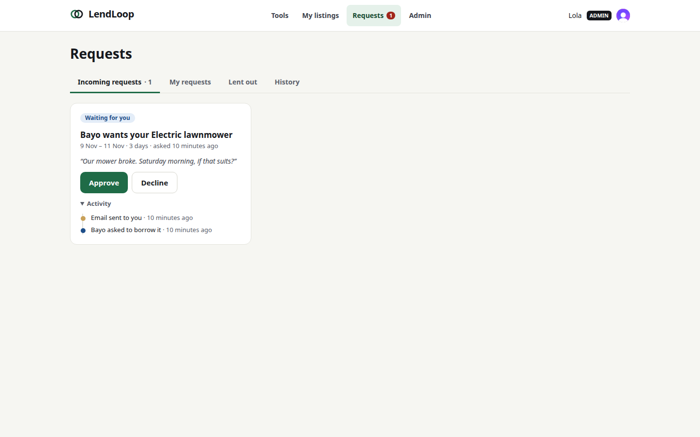 | 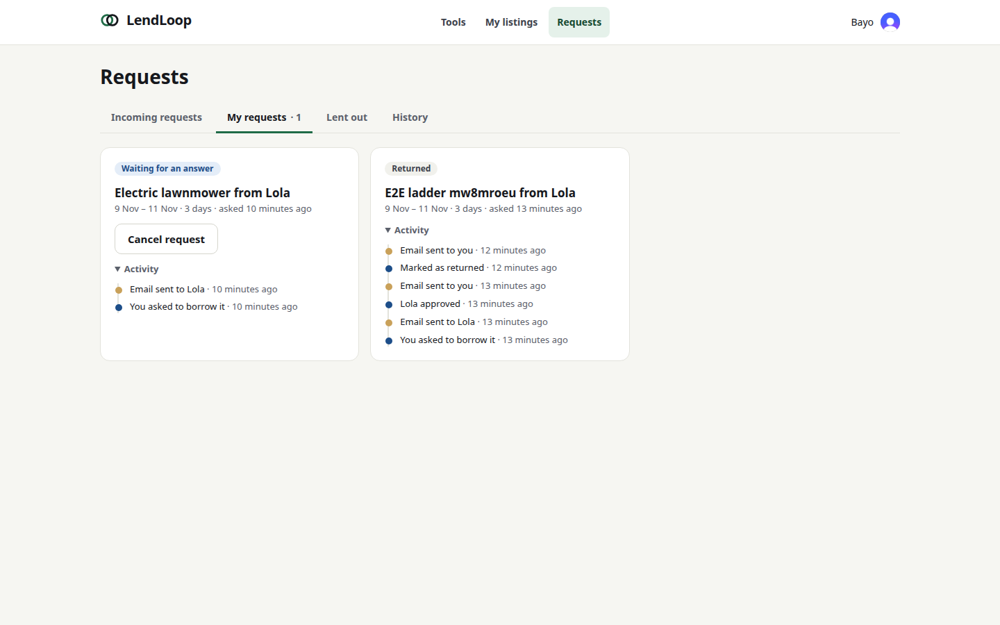 |
| 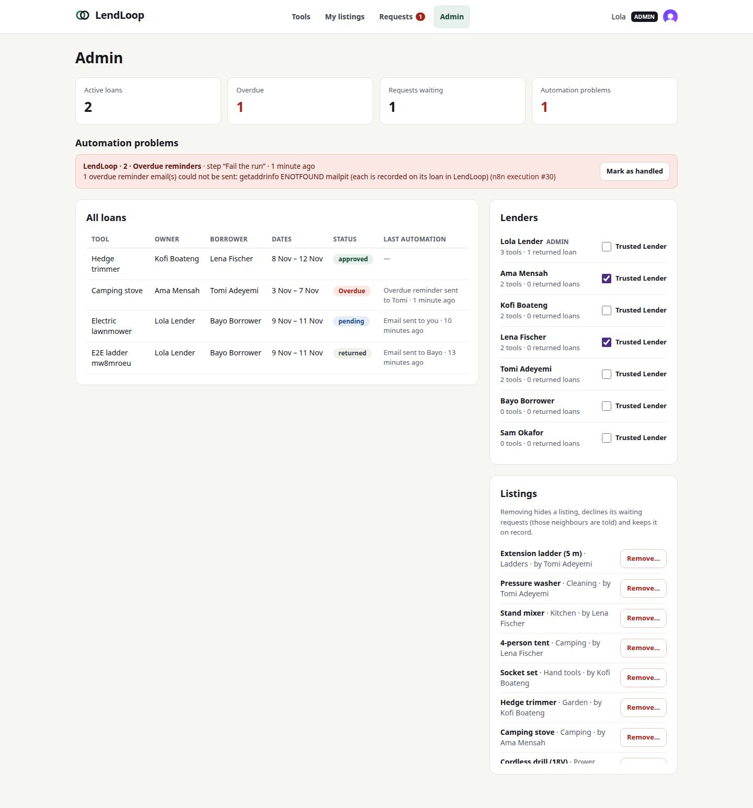 | 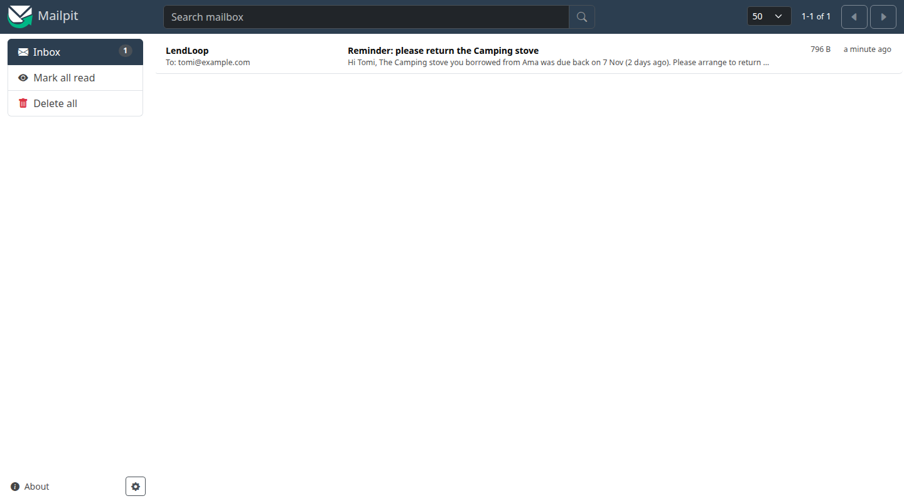 |
| 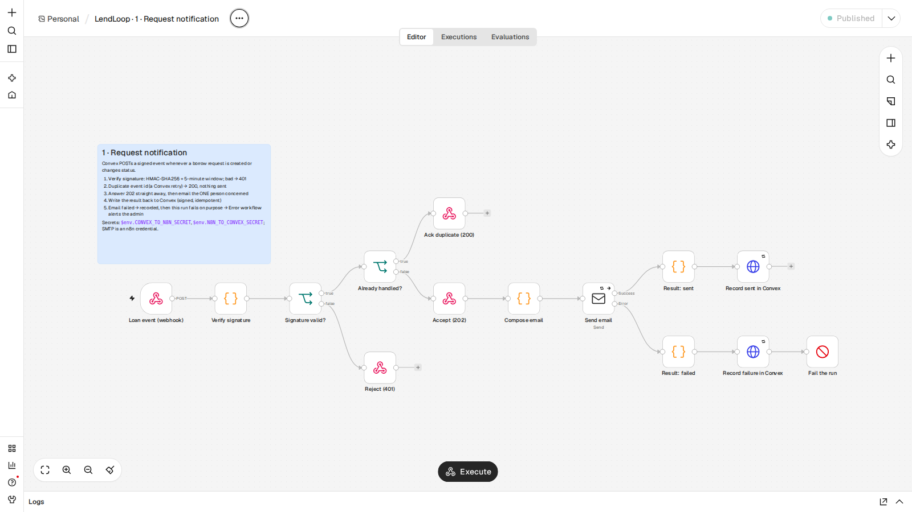 | 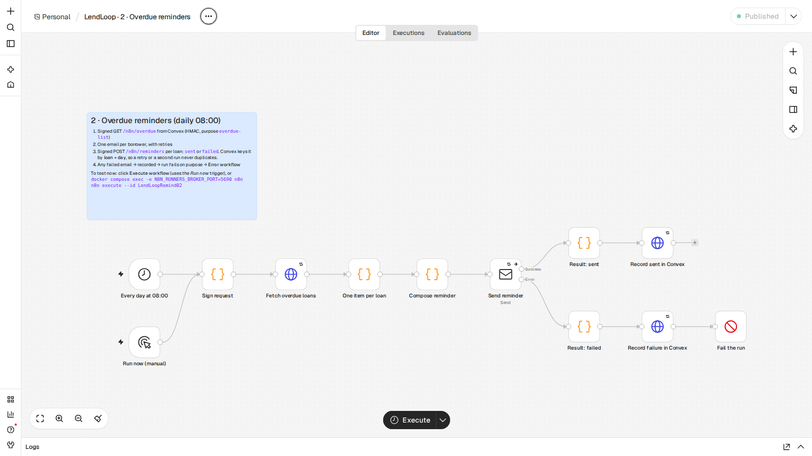 |
| 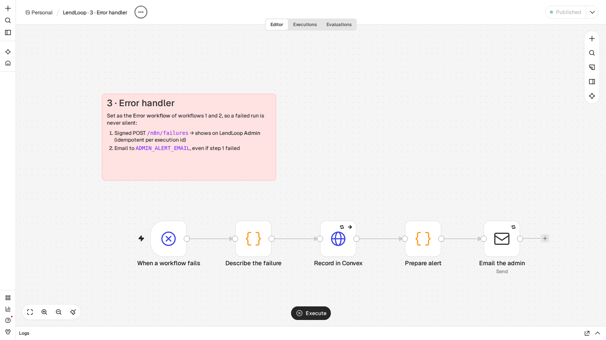 | |

</details>

---

## Quick start

**You need:** Node 20.9+, Docker, and a free [Clerk](https://clerk.com) account. A Convex account is optional.

```bash
git clone <this repo> lendloop && cd lendloop
npm ci
```

### 1. Clerk

1. Create a Clerk application with email sign-in.
2. In the Clerk dashboard, open **Integrations → Convex** and click **Activate**. This creates the `convex` JWT
   template. Note the **Frontend API URL** it shows, for example `https://your-app.clerk.accounts.dev`.
3. Copy `.env.local.example` to `.env.local` and paste in your two Clerk keys.

### 2. Convex (local backend)

```bash
npx convex dev            # keep running in its own terminal
```

When it asks, choose a **local** deployment. With no Convex account at all, use
`CONVEX_AGENT_MODE=anonymous npx convex dev`. It writes `NEXT_PUBLIC_CONVEX_URL` into `.env.local`.

Then point Convex at Clerk:

```bash
npx convex env set CLERK_JWT_ISSUER_DOMAIN https://your-app.clerk.accounts.dev
```

> **Why local?** A cloud Convex deployment cannot call `http://localhost:5678`. To use cloud Convex, expose n8n
> with a tunnel (for example `cloudflared tunnel --url http://localhost:5678`) and set `N8N_WEBHOOK_URL` to it.
> The other direction (n8n → `https://<deployment>.convex.site`) works as is.

### 3. Secrets and n8n

```bash
npm run setup:secrets -- --convex   # writes .env with fresh random secrets, and copies the HMAC ones into Convex
docker compose up -d                # n8n + Mailpit; imports the credential and the 3 workflows, then publishes them
```

- **n8n:** http://localhost:5678. Create the owner account on your first visit. The workflows are already imported and live.
- **Mailpit:** http://localhost:8025. Every email the workflows send lands here.

### 4. Run it

```bash
npm run seed              # optional demo neighbours, tools and one overdue loan
npm run dev               # http://localhost:3000
```

Sign in, list a tool, then sign in as a second person in a private window and request it. The owner's email
appears in Mailpit within a second, and the request card shows **Activity → Email sent to you**.

**Make yourself admin.** Sign in once, then:

```bash
npx convex run users:setRole '{"email":"you@example.com","role":"admin"}'
```

`setRole` is an *internal* function, so only someone with access to the deployment can run it. There is no
endpoint that grants admin.

**Run the reminder workflow now.** Open *LendLoop · 2 · Overdue reminders* in n8n and click **Execute workflow**.
Or, from a terminal:
`docker compose exec -e N8N_RUNNERS_BROKER_PORT=5690 n8n n8n execute --id LendLoopRemind02`

**See a failure handled.** Run `docker compose stop mailpit`, run the reminders, then `docker compose start mailpit`.
The loan shows "Overdue reminder failed". The Admin page shows the failed run with its cause, and the admin is
emailed. Run the reminders again and the same record becomes "sent", with no duplicate.

---

## Environment variables

| Variable | Lives in | Secret | Purpose |
|---|---|:-:|---|
| `NEXT_PUBLIC_CONVEX_URL`, `CONVEX_DEPLOYMENT` | `.env.local` (Next) | – | Written by `npx convex dev` |
| `NEXT_PUBLIC_CLERK_PUBLISHABLE_KEY` | `.env.local` | – | Clerk browser key |
| `CLERK_SECRET_KEY` | `.env.local` | **yes** | Clerk server key (Next server only) |
| `CLERK_JWT_ISSUER_DOMAIN` | Convex env | – | Issuer of the `convex` JWT that Convex verifies |
| `CONVEX_TO_N8N_SECRET` | Convex env **and** `.env` (n8n) | **yes** | HMAC key, Convex → n8n |
| `N8N_TO_CONVEX_SECRET` | Convex env **and** `.env` (n8n) | **yes** | HMAC key, n8n → Convex |
| `N8N_WEBHOOK_URL` | Convex env | – | Where Convex posts loan events (`…/webhook/lendloop-events`) |
| `APP_TIMEZONE` | Convex env | – | The neighbourhood's calendar ("what day is today"). Default `UTC` |
| `N8N_ENCRYPTION_KEY` | `.env` | **yes** | Encrypts credentials stored in n8n |
| `CONVEX_SITE_URL_FOR_N8N` | `.env` | – | Convex HTTP actions as seen from Docker (`http://host.docker.internal:3211` locally) |
| `APP_URL`, `MAIL_FROM`, `ADMIN_ALERT_EMAIL`, `TIMEZONE` | `.env` | – | Links in emails, sender, who gets failure alerts, n8n's clock |

`.env` and `.env.local` are git-ignored. `npm run setup:secrets` never prints a secret, and it passes values to
the Convex CLI as process arguments, never through a shell. The SMTP login is an **n8n credential**, encrypted at
rest. The committed one is the password-less local Mailpit server.

---

## Architecture

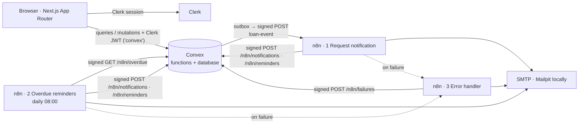

**Convex** ([`convex/`](convex)):

| File | Role |
|---|---|
| `schema.ts` | `users`, `tools`, `loans`, `outbox`, `automationEvents`, `automationFailures`, with indexes |
| `lib/auth.ts` | `requireUser` / `requireAdmin` / `requireOwnTool`. The role is read from **our** table, never from the client |
| `tools.ts`, `loans.ts`, `admin.ts`, `users.ts` | Public API. Each function starts with an access check |
| `outbox.ts` | Transactional outbox: signed delivery to n8n, backoff retries, dead letters |
| `http.ts` | The only routes n8n can call. Each verifies the HMAC before doing anything |
| `automation.ts` | Overdue list, idempotent write-backs, the per-loan activity timeline |
| `crons.ts` | A 10-minute outbox sweep, as a safety net |
| `seed.ts` | Internal demo data (`npm run seed`) |

**Why an outbox?** The loan change and the "tell n8n" row are written in the **same transaction**. An event can't
be lost if the process dies after the write, and it can't be sent for a change that rolled back. Delivery
happens afterwards, in a scheduled action that can retry.

**Why does the role live in Convex, not in Clerk metadata?** One source of truth, checked by the same code that
reads the data. Promotion is an internal function, so no API path exists to become an admin.

**n8n** ([`n8n/workflows/`](n8n/workflows)). Each workflow carries a sticky note explaining its steps.

1. **Request notification.** Webhook (raw body kept) → **verify signature** → duplicate check → reply `202` →
   compose the email → send (3 tries) → signed write-back `sent` / `failed`. If the email failed, the run then
   fails on purpose, so the error workflow is called.
2. **Overdue reminders.** Daily at 08:00, plus a *Run now* trigger → signed GET of today's overdue loans → one
   email per borrower → signed write-back for each.
3. **Error handler.** Set as the error workflow of 1 and 2. It records the failure in Convex (shown on the Admin
   page) and emails the admin, even if recording failed.

---

## Security and data minimisation

**Access control is enforced in Convex, not just in the UI.**
- Every public function calls `requireUser` or `requireAdmin` first, then checks ownership against the record:
  "only the tool's owner can approve", "only the borrower can cancel".
- Next.js protects the signed-in pages in a server layout (`auth.protect()`). That only decides where people are
  sent; the data is guarded by Convex.
- Tests call every function **directly**, as a tampered client would, and expect a `FORBIDDEN` or
  `UNAUTHENTICATED` code. Each refusal sits next to a positive control.
- Input is validated on the server: Convex validators for categories, conditions and ids, plus length and date
  rules. The form's checks are a convenience that mirrors them.

**Signed integration, in both directions.**
- Signature: `HMAC-SHA256(secret, "<unix ts>.<purpose>.<raw body>")`, sent as `X-LendLoop-Signature: v1=<hex>`
  with `X-LendLoop-Timestamp`.
- **Purpose binding:** a signature made for "write a reminder result" is rejected by "record a failure", so a
  captured request can't be replayed at a different endpoint.
- **Replay window:** the timestamp must be within ±5 minutes.
- **Constant-time comparison:** `crypto.subtle.verify` in Convex, `crypto.timingSafeEqual` in n8n.
- **Two secrets, one per direction.** A leaked n8n-side key can't forge events *into* n8n, and the reverse also holds.
- n8n verifies against the **raw request bytes** (the Webhook node's *Raw Body* option), not re-serialised JSON.
- A bad signature gets `401` and nothing else happens. The reason is logged; the body never is.

**Data minimisation.**
- **Public list:** tool name and category only. No ids, no owner, no description.
- **Browse view:** the owner's first name only. The dates already promised are shown without saying who has them.
- **Event payload to n8n:** recipient first name and email, the *other* person's first name, tool name and dates.
  No surnames, no second email address, no note, description, condition or role. A test pins this exact set of
  keys.
- **Overdue list:** borrower first name and email, tool name, owner's first name, due date. It contains only
  loans not yet reminded today.
- **n8n execution data** (which contains emails) is pruned after 7 days (`EXECUTIONS_DATA_MAX_AGE=168`).
- **Emails are plain text**, with no tracking pixels or open tracking.

**Secrets.**
- The HMAC secrets are read from the environment (`$env` in n8n, Convex environment variables).
- SMTP is an n8n credential.
- Exported workflow JSON holds only credential `{id, name}` references.
- [`scripts/check-workflows.mjs`](scripts/check-workflows.mjs) runs in CI and fails on any key-, hex-, base64- or
  password-shaped value in the exports.

---

## Reliability and error handling

| What fails | What happens | Where you see it |
|---|---|---|
| n8n is down or slow (Convex → n8n) | Outbox retries 5× with backoff (30 s, 2 m, 10 m, 1 h, 6 h). Then the row is marked **dead** and an `automationFailures` row is written | The loan's timeline ("Notification delayed, retrying (2 of 5)"), then the Admin page with a **Retry delivery** button |
| A delivery was interrupted (deploy, crash) | A cron re-dispatches stale pending rows every 10 minutes | – |
| Convex retries an event n8n already handled | n8n remembers recent `eventId`s and answers `200 duplicate`, sending no second email | – |
| SMTP fails | The email node retries 3× and records `failed` on the loan. Then the run fails on purpose → error workflow | Loan timeline in red, Admin page with the real cause, admin email |
| Convex is unreachable from n8n | The HTTP nodes retry 3×, then the run fails → error workflow | Admin email (the failure *record* can't be written, which is why the email is sent regardless) |
| A write-back is retried | Idempotency keys `notify:<eventId>`, `reminder:<loanId>:<day>` and `n8n:<executionId>` are checked inside one serialisable mutation. Repeats return `duplicate`. A later success upgrades an earlier failure, never the reverse | – |
| Reminders run twice on one day | The overdue list leaves out loans already reminded today | – |

Tested against the real stack (Convex local backend, n8n 2.46.6, Mailpit):
- forged, tampered, stale and duplicate webhooks;
- a write-back for an unknown event (error workflow → Admin page and admin email);
- Mailpit stopped mid-run, then recovered (the failed reminder turned into "sent", with no duplicate).

The Convex → n8n retry, dead-letter and admin-retry path is covered by unit tests with a failing `fetch`.

---

## Tests

```bash
npm run check        # typecheck + lint + unit tests + secret scan (what CI runs)
npm run test:e2e     # browser tests (needs the stack running and Clerk *development* keys)
```

- **24 Convex tests** ([`tests/`](tests), with `convex-test`):
  - access control (every refusal by error code, plus positive controls);
  - booking rules and auto-decline;
  - the exact payload fields;
  - the HMAC (unsigned, wrong secret, wrong purpose, stale, tampered);
  - idempotent write-backs;
  - outbox delivery, retry, dead-letter and admin retry.
- **5 Playwright tests** ([`e2e/`](e2e)): two real people signed in through Clerk (testing tokens) run the whole
  loop of list, request, approve and return. When Mailpit is running, the test also checks that the n8n emails
  arrived and that the activity timeline shows them.
- **CI** ([`.github/workflows/ci.yml`](.github/workflows/ci.yml)) runs `npm run check` on every push.

---

## Decisions and trade-offs

- **Calendar days, not timestamps, for loans.** A loan is "14–17 Nov". "Today" comes from `APP_TIMEZONE`, never
  from the server's clock, so overdue means the same thing to everyone in the neighbourhood.
- **Approving auto-declines overlaps** rather than leaving stale requests nobody can act on.
- **The `202` reply comes before the email is sent.** Convex's retry covers *delivery* to n8n, and n8n's retries
  cover *sending*. Waiting for SMTP inside the webhook would make every slow mail server look like n8n being down.
- **The n8n dedupe memory is workflow static data**, the last 1,000 event ids. That is plenty here. At scale it
  would be a lookup against Convex (see production notes).
- **Two HMAC secrets in env vars.** n8n's Code node reads `$env`, which needs `N8N_BLOCK_ENV_ACCESS_IN_NODE=false`.
  That is acceptable on a single-tenant instance. In production the signing would move to n8n's external
  secrets (see below).
- **No email for "returned" to the owner.** The owner is the one who clicks it.

## Running this in production

See **[docs/PRODUCTION.md](docs/PRODUCTION.md)**.

---

MIT licence.
